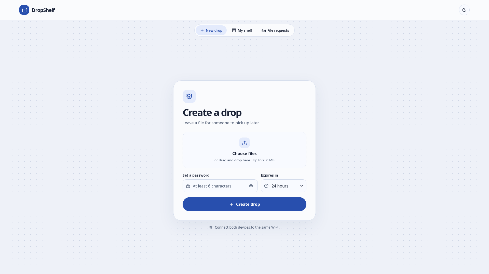
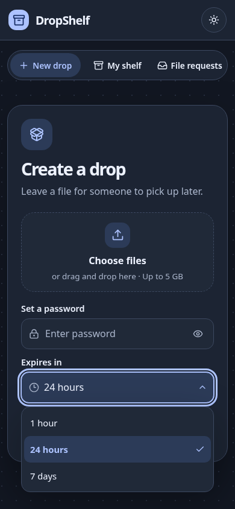
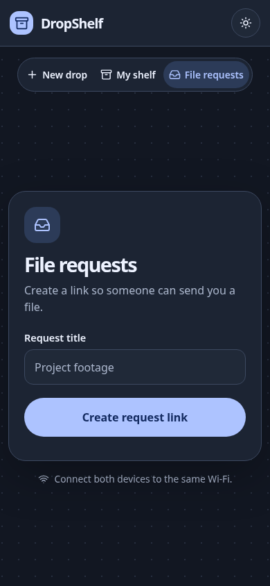

# DropShelf

DropShelf is a file-sharing web app for picking up files later. Create a password-protected link, send it to a friend, and let them download the files whenever they’re ready. You can also create a link that lets someone send a file back to you.

| Expiry picker on mobile | File requests on mobile |
| --- | --- |
|  |  |

## What you can do

| Feature | How it works |
| --- | --- |
| Create a drop | Choose or drag in up to 10 files totaling 5 GB. Set a password of your choice and pick an expiry of one hour, 24 hours, or seven days. |
| Share a link or QR code | Copy the link or let someone scan the QR code. Give the recipient the password separately. The sender can close the upload tab while the server stays online. |
| Download one file or everything | After unlocking a drop, download individual files or the complete ZIP. Browsers that support resuming can continue a partial download while the drop is active. |
| Ask for access | A recipient who needs access can enter their name. In **My shelf**, the sender opens the drop and approves or declines. The recipient checks the decision in the same browser and can download after approval. |
| See pickup activity | Open a drop in **My shelf** to see how many download sessions started and when the latest one began. |
| Revoke a drop | Use **Revoke link** to stop new downloads and remove the shared copy. Expired files are also cleared automatically. |
| Request a file | Create a seven-day upload link in **File requests**. Anyone with the link can submit a file up to 5 GB. Open the request in the browser that created it to see and download incoming files. |
| Switch themes | The interface follows your device theme by default. Use the theme button to switch between light and dark mode on desktop or mobile. |

## How it works

Next.js and TypeScript build the web interface. FastAPI streams uploads to a private folder and uses SQLite for drop details, password hashes, expiry, and access requests. The backend checks the download link each time a file is requested. Management keys live in the browser that created each drop or request.

[Local setup guide](guide.md#run-and-try-it)
